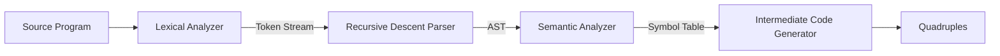

<div align="center">

# ⚙️ Mini Compiler Front-End in Python

### Lexical Analysis · Syntax Analysis · Semantic Analysis · AST · Quadruple Generation


</div>

---

## 📖 About the Project

This project is a working **compiler front-end** for a small custom programming language, written in **Python**. It was developed as a hands-on practice project for the **Compiler Principles** course at Nanjing Tech University.

Given a source program, the compiler goes through every front-end phase: it breaks the code into tokens, checks the syntax, builds an Abstract Syntax Tree, validates variables with a symbol table, and finally generates **intermediate code as quadruples**.

---

## 🔄 Compilation Pipeline



| Phase | What it does |
| ----- | ------------ |
| **Lexical Analysis** | Scans the source and converts it into tokens using regular expressions (`re`) |
| **Syntax Analysis** | Checks tokens against the grammar using a recursive descent parser |
| **AST Generation** | Builds a tree of node objects (`Program`, `Declaration`, `Assignment`, `BinaryOp`, ...) |
| **Semantic Analysis** | Builds a symbol table, detects undeclared and duplicate variables |
| **Intermediate Code** | Translates the AST into quadruples using temporary variables |

---

## ✨ Features

- 🔤 **Regex-based lexer** with token types for keywords, identifiers, numbers, operators, delimiters and booleans
- 🌲 **Recursive descent parser** built on an LL(1)-style grammar (left recursion removed)
- 🧱 **AST generation** with a dedicated node class for each construct
- 🧠 **Semantic checks**: symbol table, undeclared variable detection, duplicate declaration detection
- 🧮 **Quadruple generation** with correct operator precedence (`*` and `/` before `+` and `-`)
- 🔁 Supports **`if / else`**, **`while`** loops and **`{ }` blocks**
- 🚨 Clear **error reporting** for lexical, syntax and semantic errors

---

## 🗣️ The Language

### Data types
`int`, `string`, `bool`

### Identifiers
Variable names are written between dollar signs: `$a$`, `$name$`, `$flag$`

### Operators and symbols

| Category | Symbols |
| -------- | ------- |
| Assignment | `:=` |
| Arithmetic | `+`  `-`  `*`  `/` |
| Relational | `<`  `>`  `<=`  `>=`  `==`  `<>` |
| Delimiters | `;`  `,`  `(`  `)`  `{`  `}` |
| Keywords | `int`  `string`  `bool`  `if`  `else`  `while`  `true`  `false` |

### Sample program

```text
int $a$;
$a$ := 5 + 3 * 2;
```

### Grammar used by the parser (LL(1) style)

```text
program        → declarations statements
declarations   → declaration ; declarations | ε
declaration    → type identifier_list
identifier_list→ identifier { , identifier }
statement      → assignment | if_statement | while_statement | block
assignment     → identifier := expression
if_statement   → if ( expression ) statement else statement
while_statement→ while ( expression ) statement
block          → { statements }
expression     → term { (+|-) term }
term           → factor { (*|/) factor }
factor         → NUMBER | IDENTIFIER | TRUE | FALSE | ( expression )
```

---

## 🧪 Example Output

**Input**

```text
int $a$;
$a$ := 5 + 3 * 2;
```

**Tokens**

```text
('INT', 'int')          ('IDENTIFIER', '$a$')   ('SEMICOLON', ';')
('IDENTIFIER', '$a$')   ('ASSIGN', ':=')        ('NUMBER', '5')
('PLUS', '+')           ('NUMBER', '3')         ('MULT', '*')
('NUMBER', '2')         ('SEMICOLON', ';')
```

**Symbol table**

```text
$a$ → int
```

**Quadruples (intermediate code)**

```text
(*,  3,  2,  t1)
(+,  5,  t1, t2)
(:=, t2, -,  $a$)
```

### Error detection

| Input | Result |
| ----- | ------ |
| `int @abc;` | `Lexical Error: Invalid token near '@abc'` |
| `$a$ := 10;` (not declared) | `Semantic Error: '$a$' not declared` |

---

## 📂 Project Structure

```text
.
├── lexer.py            # Lexical analyzer (token definitions + scanner)
├── parser.py           # Recursive descent parser
├── ast_nodes.py        # AST node classes
├── semantic.py         # Symbol table and semantic checks
├── intermediate.py     # Quadruple (intermediate code) generator
├── main.py             # Runs the full pipeline
├── tests/              # Sample test programs
├── report/             # Project reports (PDF)
└── README.md
```

> Update the file names above to match the files in this repository.

---

## 🚀 Getting Started

### Prerequisites
- [Python 3.8+](https://www.python.org/downloads/)

### Run the project

```bash
# 1. Clone the repository
git clone https://github.com/Ameersubhan1/YOUR-REPO-NAME.git
cd YOUR-REPO-NAME

# 2. Run the compiler on a source file
python main.py tests/sample.txt
```

The lexer can also be run on its own:

```bash
python lexer.py tests/sample.txt
```

---

## 🧩 Key Design Decisions

- **Left recursion removal:** rules such as `expression → expression + term` were rewritten as `expression → term expression'` so that recursive descent does not loop forever.
- **Operator precedence:** the parser is split into `parse_expression()`, `parse_term()` and `parse_factor()`, so multiplication and division are always grouped before addition and subtraction.
- **Temporary variables:** complex expressions are broken into simple steps using `t1`, `t2`, ... which keeps quadruple generation clean.
- **Ordered token matching:** keywords are matched before identifiers, and longer operators (`>=`, `<=`, `==`, `<>`, `:=`) are matched before shorter ones.

---

## 🔮 Future Improvements

- [ ] Type checking (for example, assigning a string to an `int`)
- [ ] Better error recovery so multiple errors can be reported in one run
- [ ] Target code generation (assembly or bytecode)
- [ ] Code optimization (constant folding)
- [ ] Interactive web interface showing tokens, AST, symbol table and quadruples

---

## 📚 References

- Aho, A.V., Lam, M.S., Sethi, R. and Ullman, J.D. (2006) *Compilers: Principles, Techniques, and Tools*. 2nd edn. Pearson.
- Python Software Foundation, [`re` – Regular expression operations](https://docs.python.org/3/library/re.html)

---

## 👨‍💻 Author

**Ameer Subhan Hussain**
Nanjing Tech University — Compiler Principles

- GitHub: [@Ameersubhan1](https://github.com/Ameersubhan1)

<div align="center">

⭐ If you found this project useful, please give it a star!

</div>
